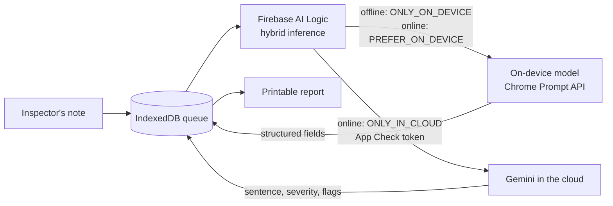

# Plumb

Plumb is a Chrome web app for property and field inspectors. It captures
findings where there is no signal, using Gemini Nano on the device, and turns
them into a clear report once the connection is back, using Gemini in the
cloud. Both tiers run through
[Firebase AI Logic](https://firebase.google.com/docs/ai-logic/hybrid) hybrid
inference.

## What it does

1. **Capture.** Type a short note such as `kitchen outlet next to sink has no
   gfci`. The note is saved to IndexedDB first, then structured into fields
   (`room`, `item`, `issue`, `size_cm`, `water_related`) by the on-device
   model. Click the floor plan to pin it.
2. **Queue.** Findings stay on the device. With no connection, nothing is
   sent anywhere.
3. **Reconnect.** Cloud Gemini writes the report sentence, assigns a severity
   (Low, Moderate, High) and flags water and safety issues. Rooms on the plan
   take the color of their worst finding.
4. **Report.** One page with summary counts, the pinned plan and every
   finding, printable or saved as PDF from the browser.

A routing log shows every model call: the inference mode it was made with,
the tier that answered, the measured latency and the network state. The
**Simulate offline** switch is a demo control: it forces device-only calls
and holds cloud sync, so the offline path can be shown without leaving the
network.

## Why hybrid

An inspector walking through a basement or a stairwell often has no
connection, so anything that has to work during the walkthrough must run on
the device. Judging how serious a defect is, and writing it up clearly, is a
harder task that benefits from a larger model. Plumb splits the work along
that line:

| Step | Inference mode | Why |
|---|---|---|
| Structure a note, online | `PREFER_ON_DEVICE` | Uses the on-device model when the browser has it. Falls back to the cloud on machines without one. |
| Structure a note, offline | `ONLY_ON_DEVICE` | Never reaches the cloud, so it keeps working with the network off. |
| Polish wording and assign severity | `ONLY_IN_CLOUD` | A judgment call that waits for a connection instead of falling back to the small model. |

The app reads `response.inferenceSource` from the SDK and shows which tier
answered each call, with the latency measured in the browser.



Two details in the code keep the split honest:

- Without Chrome's Prompt API the SDK sends even `ONLY_ON_DEVICE` requests
  to the cloud. Plumb checks for the API first and refuses the call instead,
  so "device only" never leaves the device.
- App Check tokens are only attached to cloud requests. On-device calls need
  no token, which is why capture works with the network off.

## Requirements

- Chrome desktop 148 or later on Windows, macOS, Linux or Chromebook Plus.
  On-device inference needs about 22 GB of free disk space and either a GPU
  with more than 4 GB of VRAM or 16 GB of RAM with 4 or more cores. See
  Chrome's [built-in AI requirements](https://developer.chrome.com/docs/ai/get-started).
- Node.js 22.12 or later.
- A Firebase project with Firebase AI Logic enabled (Gemini Developer API)
  and App Check.

## Setup

1. Install dependencies.

   ```bash
   npm install
   ```

2. In the [Firebase console](https://console.firebase.google.com/), create a
   project, open **AI Services > AI Logic**, choose the Gemini Developer API
   and register a web app.

3. Copy the example environment file and fill in the web app config.

   ```bash
   cp .env.example .env
   ```

4. Set `VITE_APPCHECK_DEBUG_TOKEN=true` in `.env`, start the dev server and
   open the page.

   ```bash
   npm run dev
   ```

   The DevTools console prints an App Check debug token. Register it under
   **Security > App Check > Apps > Manage debug tokens**. Treat the token as
   a secret: keep it in `.env` and never commit it.

5. If the app says the on-device model is not downloaded yet, click
   **Download model** once while online.

To try the offline app shell locally, run `npm run build` and
`npm run preview`. The service worker is only registered in production
builds.

For a hosted build, create a reCAPTCHA Enterprise key for your domain,
register it as the App Check provider and set
`VITE_RECAPTCHA_ENTERPRISE_SITE_KEY`. The debug token is only read by the dev
server on localhost and is left out of production builds.

## Project layout

```
index.html        The app: capture view and report view
bench.html        Routing bench, a developer page for testing each route
vite.config.ts    Build config and the app shell service worker
src/
  app.ts          State, capture and sync pipeline, rendering
  plan.ts         SVG floor plan, pins and heat map
  report.ts       Printable report
  store.ts        IndexedDB: findings, routing log, site name
  firebase.ts     Firebase app, App Check and the single getAI() call
  ai/models.ts    One model instance per routing decision
  ai/schema.ts    Shared JSON schemas, prompts and output validation
  ai/run.ts       Timed model calls that record which tier answered
```

## Limitations

- English input only.
- Chrome desktop only. Other browsers and mobile Chrome have no on-device
  model, so only the cloud path works there.
- The first use downloads the on-device model, which needs an unmetered
  connection.
- One inspection at a time, on a built-in demo floor plan. Pins are placed
  by the inspector; the model does not locate findings.
- Severity is a model's suggestion and needs an inspector's review.
- No photos or voice input yet.

## License

[Apache License 2.0](LICENSE)
