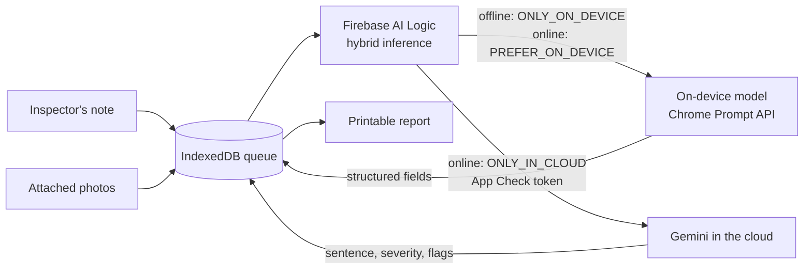

# Plumb

Inspectors often work in places with no internet: basements, warehouses,
remote sites. When the signal drops, findings end up on paper and get retyped
later, which costs time and accuracy. Plumb is for those moments.

Plumb is a Chrome web app for any site visit. It captures findings where
there is no signal, using Gemini Nano on the device, and turns them into a
clear report once the connection is back, using Gemini in the cloud. Both
tiers run through
[Firebase AI Logic](https://firebase.google.com/docs/ai-logic/hybrid) hybrid
inference.

**Try it:** https://plumb-2ae89.web.app (Chrome desktop, no login).

## Testing the hosted demo

1. Open https://plumb-2ae89.web.app once while online, in Chrome desktop 148
   or later (see [Requirements](#requirements) for hardware and disk space).
   This first visit also caches the app, so it opens later without a network.
2. If a banner says the on-device model is not downloaded yet, click
   **Download model** and wait for the percentage to finish. This is a
   one-time download managed by Chrome.
3. Turn on **Simulate offline** (or disconnect) and add a note. It is
   structured on the device, and the routing log shows "On device".
4. Turn the switch off (or reconnect). The cloud model writes the report
   sentence and severity. Open **Report** to see the result.

Without the on-device model (other browsers, unsupported hardware, or before
the download finishes), notes are structured in the cloud while online. While
offline they are saved and structured on reconnect.

## What it does

1. **Start a visit.** Name the site and pick a visit type: rental move-out,
   warehouse safety walk-through, construction punch list, restaurant health
   check, or a custom type you name yourself.
2. **Capture.** Type a short note such as `storage rack upright bent about 6
   inches near aisle 3`. The note is saved to IndexedDB first, then
   structured into fields (area, item, issue, size and unit, water flag) by
   the on-device model.
3. **Areas appear from your notes.** There is no fixed floor plan. The area
   each note names becomes a tile on the site map, marked "Created from
   note", and the finding is pinned inside it. If the model reads an area
   wrong, fix it: add an area, rename one (renaming to an existing name
   merges the two), drag a pin to another tile, or pick the area on the
   finding's card.
4. **Attach photos.** Pick image files or use the camera. Photos are
   downscaled in the browser to at most 1280 px, stored as JPEG in IndexedDB
   and need no connection.
5. **Reconnect.** Cloud Gemini writes the report sentence, assigns a severity
   (Low, Moderate, High) and flags water and safety issues. Each tile takes
   the color of its worst finding.
6. **Report.** One page with a summary, the count per area, every finding
   sorted by severity and its photos, printable or saved as PDF from the
   browser. It is stamped "Ready for review" once every finding has a severity
   from the cloud model; until then it is stamped "Draft".

A routing rail draws every model call on one of two lanes, "On device" or
"Cloud", with its measured latency, so the split can be read at a glance.
While a note is being structured on the device, the card shows the model's
JSON as it is written. When the signal drops, the map and the findings lose
their color, and it returns with a wave on reconnect.

A routing log shows every model call: the inference mode it was made with,
the tier that answered, the measured latency and the network state. The
figures next to it (fields extracted offline, prompt bytes sent to the cloud
while offline, cloud polish calls, median on-device latency) are counted from
that log and from the stored findings. Nothing on the screen is a
placeholder.

The app is dark by default, which suits the dim places inspections happen
in, and has a light theme for daylight sites. The choice is remembered.

The **Simulate offline** switch is a demo control: it forces device-only
calls and holds cloud sync, so the offline path can be shown without leaving
the network. Calls made with it on are marked "offline (simulated)" in the
log.

## Why hybrid

On site there is often no connection, so anything that has to work during
the visit must run on the device. Judging how serious a defect is, and
writing it up clearly, is a harder task that is left to a cloud model.
Plumb splits the work along that line:

| Step | Inference mode | Why |
|---|---|---|
| Structure a note, online | `PREFER_ON_DEVICE` | Uses the on-device model when the browser has it. Falls back to the cloud on machines without one. |
| Structure a note, offline | `ONLY_ON_DEVICE` | Never reaches the cloud, so it keeps working with the network off. |
| Polish wording and assign severity | `ONLY_IN_CLOUD` | A judgment call that waits for a connection instead of falling back to the on-device model. |

The app reads `response.inferenceSource` from the SDK and shows which tier
answered each call, with the latency measured in the browser.



Two details in the code keep the split honest:

- Without Chrome's Prompt API the SDK sends even `ONLY_ON_DEVICE` requests
  to the cloud. Plumb checks for the API first and refuses the call instead,
  so "device only" never leaves the device.
- App Check tokens are only attached to cloud requests. On-device calls need
  no token, which is why capture works with the network off.

## Measured on-device results

Measured with Chrome 158 on one Mac laptop, using the same prompt and schema
as the app, on a 30-note test set across four visit types (warehouse,
restaurant, construction, rental). One run, so treat the figures as a
snapshot, not a benchmark.

| Field | Correct |
|---|---|
| Area (free text, matched after normalizing) | 93% |
| Item | 100% |
| Size, including "no size" | 100% |
| Water flag | 97% |
| Valid JSON | 100% |

Median latency was about 2.7 s per note and the 95th percentile about 3.4 s.
The first on-device call after a page load can take around half a minute
while Chrome loads the model into memory, so the app makes one warm-up call
at startup and shows it in the routing log.

Three things moved these numbers during tuning:

- Few-shot examples in the instructions. Without them the model left sizes
  given in meters empty and guessed an area for notes that named none. Size
  accuracy went from 83% to 97%.
- The model reports the number and the unit, and the app converts to
  centimeters. Asked to convert, the model sometimes got the arithmetic wrong
  (2 ft became 75.7 cm in the test set, and 2 m became 2000 cm in the app).
  Size accuracy went from 97% to 100%.
- The JSON schema is left out of the model's input. The output is still
  constrained by it, and the prompt is shorter. Across all three changes,
  median latency went from about 3.6 s to about 2.7 s.

The area misses that remain are places named only as part of the item ("bar
ice machine", "balcony railing"), which the model files under General. That
is what the manual area controls are for. The one water-flag miss was an oil
spill flagged as water related. The test notes and the harness are not
included in this repository.

The cloud model for the polish step is read from Firebase Remote Config
(parameter `polish_model`), so it can be changed without a redeploy. With no
value set, the build's default is used.

The cloud step uses `gemini-3.5-flash-lite` by default, because the larger
models had a free quota of 20 requests a day when this was tested. Set
`VITE_POLISH_MODEL` to use a larger model on a project with billing.

## Requirements

- Chrome desktop 148 or later on Windows, macOS, Linux or Chromebook Plus.
  On-device inference needs about 22 GB of free disk space and either a GPU
  with more than 4 GB of VRAM or 16 GB of RAM with 4 or more cores. See
  Chrome's [built-in AI requirements](https://developer.chrome.com/docs/ai/get-started).
- On-device inference uses Chrome's built-in Gemini Nano through the Prompt
  API. The hackathon FAQ says to enable "Gemma 4 for Built-in AI" in
  `chrome://flags` to get Gemini Nano 4; `chrome://on-device-internals` shows
  whether the model is downloaded.
- Node.js 22.12 or later.
- A Firebase project with Firebase AI Logic enabled (Gemini Developer API)
  and App Check.

## Setup

1. Install dependencies.

   ```bash
   npm install
   ```

2. In the [Firebase console](https://console.firebase.google.com/), create a
   project, open **AI Services > AI Logic**, choose the Gemini Developer API
   and register a web app.

3. Copy the example environment file and fill in the web app config.

   ```bash
   cp .env.example .env
   ```

4. Set `VITE_APPCHECK_DEBUG_TOKEN=true` in `.env`, start the dev server and
   open the page.

   ```bash
   npm run dev
   ```

   The DevTools console prints an App Check debug token. Register it under
   **Security > App Check > Apps > Manage debug tokens**. Treat the token as
   a secret: keep it in `.env` and never commit it.

5. If the app says the on-device model is not downloaded yet, click
   **Download model** once while online.
6. Optional: to change the cloud model for the polish step without a
   rebuild, open Remote Config in the Firebase console, add a string
   parameter `polish_model` (for example `gemini-3.5-flash-lite`) and publish.
   If the parameter is absent or the fetch fails, the build default
   (`VITE_POLISH_MODEL`) is used.

To try the offline app shell locally, run `npm run build` and
`npm run preview`. The service worker is only registered in production
builds.

For a hosted build, create a reCAPTCHA Enterprise key for your domain,
register it as the App Check provider and set
`VITE_RECAPTCHA_ENTERPRISE_SITE_KEY`. The debug token is only read by the dev
server on localhost and is left out of production builds.

## Visit types

A visit type is a small JSON entry in `src/presets.json`. It changes only
four things: the areas suggested under the site map, a one-line wording hint
added to the capture prompt, the report headings and the example notes. To
add a visit type, add an entry to that file. No code changes are needed.

## Project layout

```
index.html        The app: visit setup, capture view and report view
bench.html        Routing bench, a developer page for testing each route
vite.config.ts    Build config and the app shell service worker
src/
  app.ts          State, capture and sync pipeline, rendering
  map.ts          Site map: area tiles, pins and heat colors
  presets.json    Visit types
  photos.ts       Photo downscaling
  rail.ts         Routing rail: calls on the device and cloud lanes
  kpi.ts          Figures counted from the routing log
  report.ts       Printable report
  store.ts        IndexedDB: visit, areas, findings, photos, routing log
  firebase.ts     Firebase app, App Check and the single getAI() call
  ai/models.ts    One model instance per routing decision
  ai/schema.ts    Shared JSON schemas, prompts and output validation
  ai/run.ts       Timed model calls that record which tier answered
  ai/remote.ts    Remote Config: the cloud model name
  presets.ts      Loads the visit types
  bench.ts        Routing bench logic
  app.css         Styles and the two themes
firebase.json     Hosting config
```

## Limitations

- English input only.
- Chrome desktop only. Other browsers and mobile Chrome have no on-device
  model, so only the cloud path works there.
- The on-device model is not downloaded automatically. Click
  **Download model** once while online; Chrome then downloads it, which needs
  an unmetered connection and enough free disk space.
- The site map is schematic. Tiles are areas in the order they were created,
  not a floor plan, and a pin marks which area a finding belongs to, not
  where in the area it is.
- Area names come from a small on-device model reading a short note. It can
  name the same place two ways or pick the wrong one, which is why areas can
  be renamed, merged and reassigned by hand.
- Photos are evidence attached by the inspector and are never sent to the
  cloud. By default no model looks at them.
- "Draft from photo" is experimental and off by default. With
  `VITE_PHOTO_ASSIST=true`, and only if Chrome reports image input as
  available for the on-device model, a photo can be read on the device to
  draft a note, which the inspector edits before adding. The draft is
  labeled as suggested by Nano. It ran end to end in Chrome 158 at about
  5 s per photo, but it has only been tried on eight synthetic drawings
  (five categorized correctly), not on real photos, so it stays off.
- Severity is a model's suggestion and needs an inspector's review.
- One visit at a time, stored in this browser only. There is no account and
  no sync between devices.
- On-device capture takes a few seconds per note on a laptop, and longer on
  the first call after a page load.
- "Uploaded while offline" counts the prompt text of this app's model
  calls. It does not measure other network traffic.
- No voice input.

## License

[Apache License 2.0](LICENSE)
